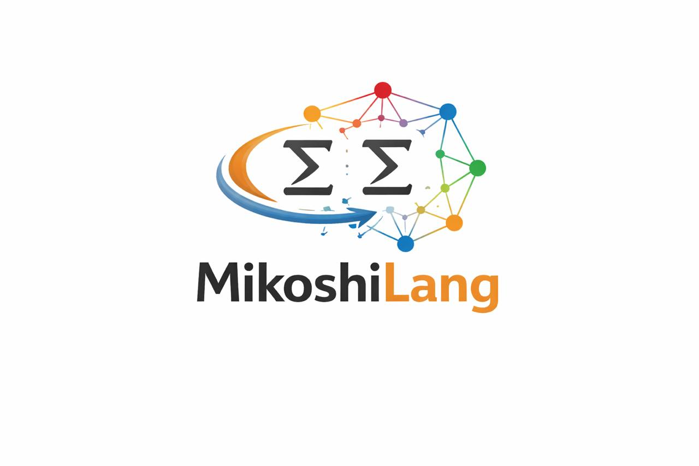

<p align="center"></p>

# MikoshiLang

**Wolfram-style symbolic computing for Python, and it tells you how it checked each answer.**

[](https://pypi.org/project/mikoshilang/)
[](https://github.com/DarrenEdwards111/MikoshiLang/actions/workflows/tests.yml)
[](https://github.com/DarrenEdwards111/MikoshiLang/actions/workflows/verification.yml)
[](LICENSE)
[](pyproject.toml)

MikoshiLang is an open-source symbolic language that runs inside Python. You write Wolfram-style code
(`f[x_] := x^2`, `Solve`, `DSolve`, `Integrate`, `Series`, pattern rules, `Module`/`Block` scoping) and get
Python values back. It is built on SymPy and NumPy and follows one rule: **a correct result, a clear error,
or left unevaluated, never silently wrong.** It implements **4,402 of the 6,716** documented Wolfram Language
symbols with reviewed, value-tested semantics (92.9% of the 4,739 that are feasible without Wolfram's curated
data, notebooks or cloud); the [coverage roadmap](docs/wolfram_coverage_roadmap.md) lists exactly which.

```sh
pip install mikoshilang            # core (SymPy + NumPy)
pip install "mikoshilang[all]"     # + Jupyter kernel, plotting, SciPy, NetworkX, scikit-learn
mikoshilang                        # REPL
```

```python
from mikoshilang import Session
s = Session()
s.eval("Solve[{x + y == 3, x - y == 1}, {x, y}]")   # {{x -> 2, y -> 1}}
s.evaluate("Verify[FactorInteger[2^64 + 1]]")      # Certified[{{274177, 1}, {67280421310721, 1}}, <|...|>]
```

**Three pillars**

- **Verification:** `Verify[expr]` re-checks a result with a method independent of the one that produced it and
  labels it `Certified` (an exact certificate was checked), `Checked` (symbolic or numerical evidence),
  `Unchecked` (no checker applies) or `Failed[value, info]`. Every reviewed function carries an executable
  `Check:` note that CI runs on every push. [More](#verification)
- **Python interop:** results come back as Python data (`Fraction`, lists, dicts, NumPy arrays), typed Python
  functions become language heads with one decorator, and calling Python from MikoshiLang is off unless you
  allow-list modules. [More](#python-interop)
- **Types (opt-in):** signatures are read from Python annotations; `Session(check_types=True)` reports type
  errors, and symbolic arguments are never type errors. [More](#types-opt-in)

Also included: a REPL, a Jupyter kernel, packed NumPy arrays, and safe defaults (network and Python access are off
unless enabled). Runnable scripts are in [`examples/`](examples/).

**What it isn't:** a Mathematica replacement or a proof assistant. It's alpha software; check results you rely on
(that is what `Verify` is for).

## Install from source

```sh
python -m pip install .
# Optional notebook, plotting, scientific and graph dependencies:
python -m pip install '.[all]'
mikoshilang
```

SciPy-backed heads such as `NDSolve` need the `signal` or `all` extra; on a minimal install they raise a
clear "requires SciPy" error.

```python
from mikoshilang import Session
s = Session()                       # isolated definitions; network disabled
assert s.evaluate('f[x_] := x^2; f[3]') == 9
assert s.evaluate('fib[0]=0; fib[1]=1; fib[n_] := fib[n] = fib[n-1] + fib[n-2]; fib[60]') == 1548008755920
assert s.evaluate('Module[{t = 2}, t^3]') == 8          # and t stays unassigned
print(s.evaluate('Solve[{x + y == 3, x - y == 1}, {x, y}]'))  # {{x -> 2, y -> 1}}
print(s.evaluate("DSolve[{y'[x] == y[x], y[0] == 1}, y[x], x]"))  # {{y[x] -> E^x}}
print(s.evaluate('Series[Exp[x], {x, 0, 3}]'))   # 1 + x + x^2/2 + x^3/6 + O[x]^4
print(s.evaluate('Sqrt[Pi]'), s.evaluate('Integrate[x^2, x]'))  # Sqrt[Pi] x^3/3
print(s.evaluate('N[Pi,50]'))            # high-precision SymPy number, not float
```

## Python interop

`Session.eval` returns Python data and keeps symbolic results as expressions; your typed Python functions
become MikoshiLang heads in one session; calling other Python code from MikoshiLang is off unless the session
allows it. Full guide: [docs/python_interop.md](docs/python_interop.md).

```python
from fractions import Fraction
from mikoshilang import Session

s = Session()
s.eval("1/3")                    # Fraction(1, 3); ints, floats, str, None, lists and dicts likewise
s.eval("0.5 - 0.5")              # 0.0 (inexact zero stays inexact)
s.eval("Integrate[x^2, x]")      # Expr x^3/3 (symbolic="sympy" gives a SymPy expression)
ml = s.ns                        # Pythonic calls; keyword arguments become options
x = ml.symbols("x")
ml.D(x**3, x), ml.Total([1, 2, 3])          # (3*x^2, 6)

@s.function(listable=True)       # session-local head CollatzSteps, typed from the hints
def collatz_steps(n: int) -> int:
    k = 0
    while n != 1:
        n, k = (n // 2 if n % 2 == 0 else 3 * n + 1), k + 1
    return k

s.eval("CollatzSteps[{1, 6, 27}]")          # [0, 8, 111]; CollatzSteps[n] stays unevaluated

t = Session(allow_python={"math"})          # off by default; a module allow-list, not a sandbox
t.eval('PythonFunction["math.gcd"][12, 18]')  # 6 (PermissionError without allow_python)
```

Python objects with no MikoshiLang form come back as session-local `PythonObject` handles
(`np = PythonImport["numpy"]; PythonFunction[np, "linalg.det"][m]`, still gated by `allow_python`), and library
authors can register global heads with `@mikoshilang.function`. Machine-number arrays from NumPy (and
`ToPackedArray`, `NumericArray`) are packed: `Dot`, `Total`, arithmetic and elementary functions on them run in
NumPy (a 200×200 `Dot` takes milliseconds instead of tens of seconds). `ExternalEvaluate` and other
code-string evaluation raise `NotImplementedError`: there is no `eval`/`exec`.

## Verification

`Verify[expr]` checks a result independently and labels it `Certified` (an exact certificate was checked),
`Checked` (symbolic or numerical evidence) or `Unchecked`, and a failed check gives `Failed[value, info]`. Each reviewed head's `Check:`
note is executable: `python scripts/verify_library.py`. Guide: [docs/verification.md](docs/verification.md).

```wolfram
Verify[FactorInteger[2^64 + 1]]   (* Certified[{{274177, 1}, {67280421310721, 1}}, <|... primality proofs ...|>] *)
Verify[Solve[x^2 == 2, x]]        (* Certified[..., <|"Method" -> "Substitution of every solution", ..., "Completeness" -> "not checked"|>] *)
Verify[Integrate[Sin[x]^2, x]]    (* Checked[x/2 - Cos[x] Sin[x]/2, <|"Method" -> "Differentiation", ...|>] *)
```

## Types (opt-in)

Library heads carry signatures read from their Python annotations; user functions can declare one. Checking is
off by default and costs nothing measurable when off. Guide: [docs/types.md](docs/types.md).

```python
from mikoshilang import Session
s = Session(check_types=True)
s.evaluate("TypeSignature[area, {Real, Real} -> Real]; area[w_, h_] := w h")
s.evaluate("TypeSignature[BitLength]")      # {{Integer} -> Expr}
s.evaluate('area[2, "3"]')                  # TypeError: area: argument 2 '3' is not of type Real (type check)
s.evaluate("area[2, h]")                    # 2 h: symbolic arguments are never type errors
```

## Language contract

What is implemented, and checked by value-level tests (see `tests/`):

- **Definitions** — `=`, `:=`, DownValues ordered by specificity (`f[0] = 1` is tried
  before `f[n_Integer]`, which is tried before `f[n_]`; ties keep definition order),
  memoisation `f[n_] := f[n] = ...`, conditional definitions `lhs := rhs /; test`
  (kept separately from the unconditional `lhs := rhs`), `Clear`, `ClearAll`, `Unset`,
  part assignment `l[[2]] = v`, `+=`, `-=`, `*=`, `/=`, `++`, `--`.
- **Patterns** — `_`, `x_`, `x_Head`, `__`, `___` (with heads), Condition `/;`,
  PatternTest `?` (`x_?EvenQ`, `_?(# > 0 &)`), `Alternatives[...]`, `HoldPattern`,
  backtracking sequence matching, Orderless (up to 8 arguments) and Flat heads.
- **Scoping** — `Module` (lexical renaming to `x$n`; like Wolfram's Temporary
  symbols, locals that escape in closures or stored definitions keep their
  values, unreferenced ones are removed), `Block` (dynamic; OwnValues,
  DownValues, SubValues and attributes are all set aside and restored, even on
  error, `Throw` or `Return`) and `With`. Substitution into `Function`, `With`,
  `Module`, rule and definition bodies is capture-avoiding: inner binders
  (including pattern names) shadow outer ones and are renamed to `x$` when a
  free symbol would otherwise be captured, so
  `Function[y, Function[x, x + y]][x]` is `Function[x$, x$ + x]`.
- **Functions** — `#`, `#n`, `##`, `body &`, `(body &)[args]`, `Function[x, body]`,
  `Function[{x, y}, body]`, `f @ x`, `x // f`, `/@`, `@@`, `@@@`, `Map`, `Apply`,
  `MapThread`, `MapIndexed`, `Select`, `Nest`, `NestList`, `FixedPoint`,
  `FixedPointList`, `Fold`, `FoldList`, `Thread`, `Outer`, `Inner`, `Identity`.
- **Control flow** — `If` (2–4 arguments), `Which`, `Switch`, `Do`, `While`, `For`,
  `Table` (multiple iterators, `{i, list}`), `Break`, `Continue`, `Return`,
  `Catch`/`Throw`, `CompoundExpression`. Loops are capped at 10^6 iterations.
- **Attributes** — `SetAttributes`/`ClearAttributes`/`Attributes` with working
  `HoldAll`, `HoldFirst`, `HoldRest`, `Listable`, `Flat`, `Orderless`
  (`SequenceHold`, `Protected`, `OneIdentity` are accepted). Arithmetic and
  elementary functions are Listable (`{1,2} + {3,4}`, `Sin[{0, Pi/2}]`).
- **Lists and structure** — `Part`/`[[ ]]` (negative indices, lists, `All`), `Length`,
  `Head`, `First`, `Last`, `Rest`, `Most`, `Append`, `Prepend`, `Join`, `Take`, `Drop`,
  `Reverse`, `Flatten`, `Sort` (canonical order for numbers, strings, symbols and
  lists, or with an ordering function), `Cases`, `DeleteCases`, `Position`, `Count`,
  `MemberQ`, `FreeQ`, `MatchQ`, `Total`, `Range`, `Dot`, `Transpose`, `Inverse`, `Det`.
- **Holding** — `Hold`, `HoldForm`, `HoldComplete`, `ReleaseHold`, `Evaluate`.
- **Strings** — `StringJoin`/`<>`, `ToString`, `StringLength`.
- **Calculus/algebra** — `D` (including `D[f, x, y]` and `{x, n}`), prime notation
  `y'[x]`, `y''[x]`, `f'[a]` for defined functions; `Solve` on equations and systems
  returning Wolfram rule lists (`{{x -> 2, y -> 1}}`, `{}` only when there is no
  solution); `DSolve` for ODEs and ODE systems in `y[x]`, with initial conditions,
  returning `{{y[x] -> ...}}` (constants `C[1]`, `C[2]`) or `y -> Function[{x}, ...]`;
  `Series[f, {x, x0, n}]` up to and including order n plus an `O[x]^(n+1)` term
  (`Normal` drops it), including multivariate `Series`; `Limit`, two-sided by default
  (`Indeterminate` when one-sided limits differ) or one-sided with `Direction -> "FromAbove"`/`"FromBelow"`.
- **Display** — the default form is re-parseable InputForm (`x^3/3`, `Sqrt[Pi]`,
  `1/(2*x)`, `E^x`); `InputForm[...]`, `FullForm[...]` (`Rational[1, 3]`), `ToString`.
- Exact integer/rational arithmetic and canonical algebra use SymPy. Decimal literals
  are machine precision; `N[..., p]` for p > 15 keeps SymPy precision. The bridges do
  not guess exact rationals from floats.
- Strict lexing: unknown characters and extra closing delimiters are errors.
  Unknown user heads remain symbolic. Definitions belong to a `Session`; the legacy
  `evaluate`/`parse_and_eval` API uses a shared default session.
- Recursion is limited to depth 1024 (`RecursionError`), `Range`/`Table` to
  100,000 entries. This is not a resource sandbox.

Also implemented: optional and default patterns (`x_.`, `x_:v`), the `|` and `..` pattern operators,
`Span` (`;;`), the `.` operator, associations (`<|"a" -> 1|>`, `Keys`, `Lookup`, ...), UpValues/TagSet
(`h /: q[h] = 7`), `Map`/`Apply` at other levels, and `Solve` over a domain (`Solve[x^2 == -1, x, Reals]`).

**Not supported (raises an error rather than guessing):** `#0` (recursive pure functions), `Function` with an
attributes argument, `Sort` of general symbolic expressions without an ordering function, `Solve` with
inequalities or logical combinations (use `Reduce`), and PDEs in `DSolve`. `%`/`Out[n]` history is not
kept by a `Session` (they stay symbolic). Term order in sums follows
SymPy's canonical order, which is close to but not always identical to Wolfram's
(e.g. `a^2 + b^2 + 2*a*b`). `Solve[expr, x]` with a bare expression is treated as
`expr == 0` (SymPy convention). The Python helper `series(expr, x, x0, n)` now also
includes the x^n term (Wolfram semantics) and returns the polynomial without `O`.

Compatibility notes for 3.8: `Solve` now returns rule lists (previously bare values);
`Inverse`/`Transpose` return plain nested lists (previously a `Matrix` head);
`Log[b, z]` is the base-b logarithm (the old bridge had the arguments reversed);
`Exp[x]` evaluates to `E^x`; sums and products are n-ary rather than nested binary.

The retained `extended`, `extended2` and `extended3` rule wrappers outside this list
are not all verified; check results for consequential uses.

## Knowledge and hosting

Knowledge access is explicit: `Session(allow_network=True)`. It may contact public
APIs and create a local SQLite cache on first use. Imports and ordinary arithmetic
no longer initialise that cache. JHTDB entries are a static catalogue, not simulations.
The direct Python knowledge APIs are still online APIs; the Session flag does not
sandbox arbitrary Python or those direct calls.

**Do not treat this package as a trusted conjecture-to-Lean translator.** There is
no typed quantifier/domain language or verified Lean translation here. Symbolic
outputs are suggestions, not proofs. Any Research Labs integration must freeze and
independently check the intended Lean statement. Untrusted evaluation requires an
external process sandbox and time/memory limits; recursion and iteration limits
alone do not provide that isolation.

## Tests

```sh
python -m pip install '.[all,test]' build
python -m pytest -q              # offline tests, including audit regressions
# A plain `pip install . pytest` also works: plotting/property suites skip.
python -m build                 # sdist and wheel
# Optional, mutable external-service integration tests (may fail offline):
python -m pytest -m live_service tests/test_knowledge.py tests/test_knowledge_full.py
```

The offline suite collects 27,742 tests (`python -m pytest --collect-only -q` with every extra installed; 50
`live_service` tests are deselected by default). Most of them are value-level checks of Wolfram semantics in
`tests/library/`.

GitHub Actions runs offline tests and package builds on Python 3.9, 3.12 and 3.13,
plus a minimal-install job without extras. `tests/test_differential_sympy.py`
compares 120+ expressions with independent SymPy computations (including Solve rule
lists and DSolve solutions substituted back into the ODE), and
`tests/test_properties.py` uses hypothesis for algebraic laws, list identities,
InputForm/FullForm round-trips, recursion and scoping. Other regressions check actual values, precision, malformed-input rejection, session
isolation, lazy branching, quarantine and offline imports. Legacy shape-only tests
are not evidence that every historical library entry works. `test_all_functions.py`
now compares expected answers and labels samples without expectations unverified.
`count_functions.py` reports active registry names, not a verified-function count.

## History: the 3.8 correctness repair

Releases up to 3.7.1 advertised "6,324 working functions". An audit showed that claim was not supported by the
implementation: many entries were generated stubs, and some gave silently wrong answers. In 3.8 the generated
modules `extended4` through `extended37` are **quarantined**: they are retained as historical source but are not
registered by the evaluator, and calling a quarantined operation raises `NotImplementedError` unless an
independently implemented core overload exists. The library was then rebuilt head by head against Wolfram's
documented semantics, with value-level tests; the audit and the list of wrong answers found and fixed are in
[docs/library_audit.md](docs/library_audit.md) and [docs/CORRECTNESS_REPAIR.md](docs/CORRECTNESS_REPAIR.md).
The retained `extended`, `extended2` and `extended3` wrappers are not all formally verified. Historical
documents in [docs/history/](docs/history/) and the pre-3.8 sections of the manual describe the old version and
are not a capability specification. See [CHANGELOG.md](CHANGELOG.md) for release notes.

## Licence

Apache-2.0; see [LICENSE](LICENSE).
